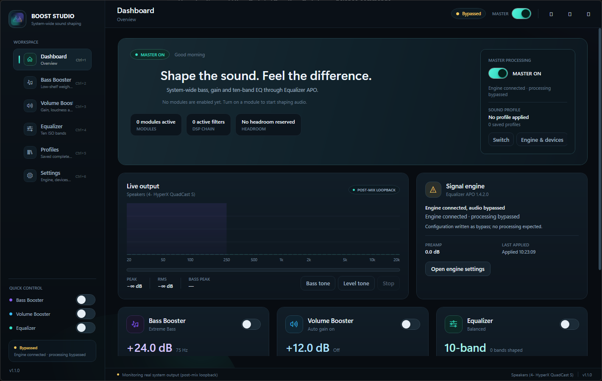
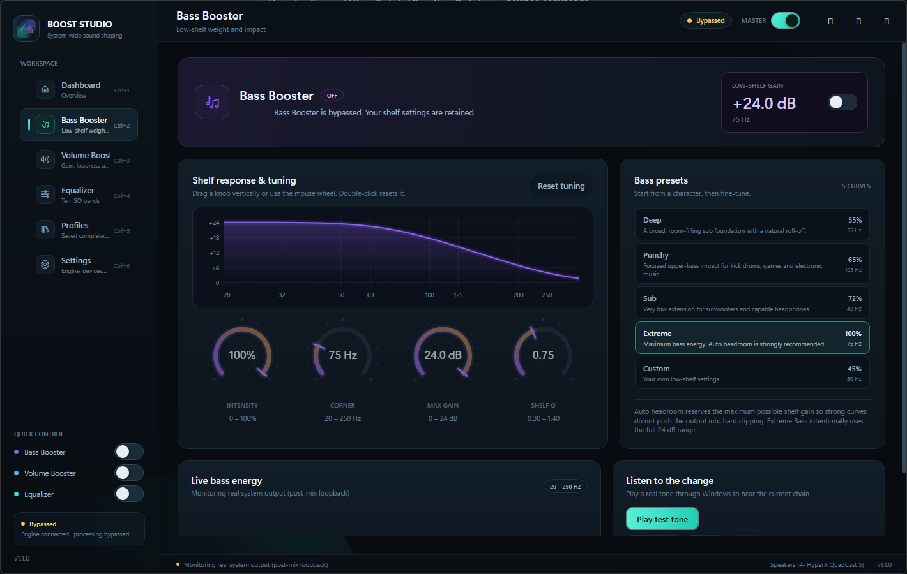
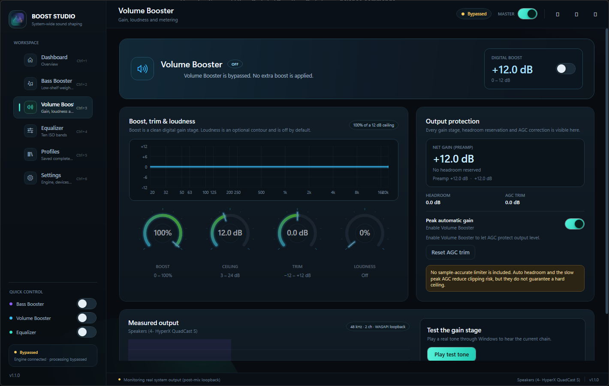
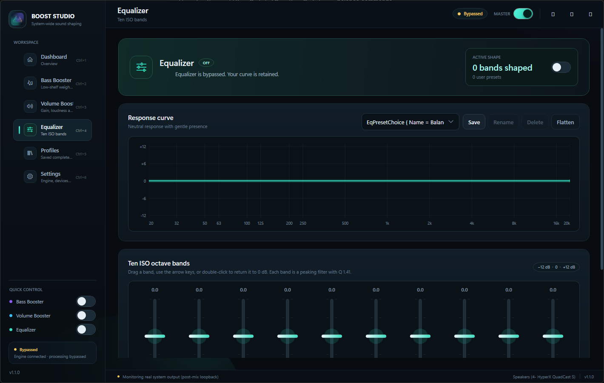
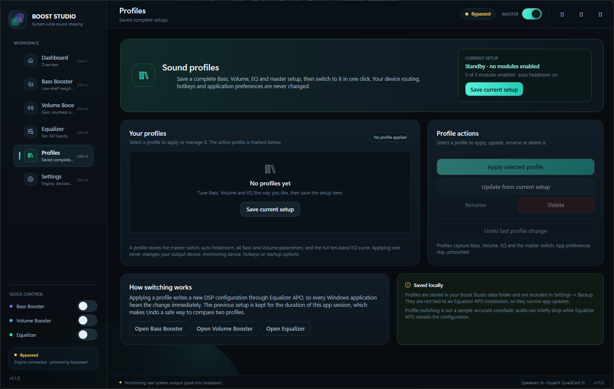

# Boost Studio

System-wide bass, volume and equalizer processing for Windows 10/11.

**Boost Studio** shapes audio from every application by integrating with
[Equalizer APO](https://sourceforge.net/projects/equalizerapo/). Bass Booster,
Volume Booster and the 10-band Equalizer can be enabled independently, so a
volume-only setup does not change the tonal balance unless you choose to add the
optional loudness contour.

## Screenshots







## Features

- **Bass Booster** — Low-shelf filter with adjustable intensity (0–100%), corner
  frequency (20–250 Hz), shelf Q, and five presets.
- **Volume Booster** — Digital gain stage with a ceiling, manual trim, optional
  loudness contour (off by default), optional slow peak AGC, automatic headroom,
  peak meter, and clip warning. The UI shows the honest net gain after headroom.
- **10-Band Equalizer** — ISO octave bands (31 Hz–16 kHz), draggable sliders,
  live response graph, built-in and user presets.
- **Sound profiles** — Save a complete Bass, Volume, EQ, auto-headroom and master
  setup, then switch to it from the app, the tray menu, or one click. Profiles
  never change your output device, hotkeys or application preferences. The app
  tracks whether the active profile has been modified and can undo the last
  profile switch.
- **Independent modules** — Bass and Volume have separate DSP, ON/OFF state,
  parameters, presets, bypass and persistence. All four ON/OFF combinations are
  covered by tests.
- **Processing output scope** — Apply DSP to every APO-enabled output, or pin it
  to one selected output. Monitoring is configured separately.
- **APO status by output** — Settings lists each active output and whether the
  Equalizer APO APO is registered on it. If the current Windows default output
  is not APO-enabled but another output is, the dashboard offers to switch to
  that working output after confirmation.
- **Fast navigation** — `Ctrl+1`–`Ctrl+6` jump between pages, `Ctrl+M` toggles
  master processing, and the window restores its last size, position and
  maximized state. A second launch activates the running window instead of
  showing an "already running" dead end.
- **Least-privilege setup** — The main UI runs as a standard user. A one-time
  elevated helper grants your account Modify access to `config.txt` and
  `BoostStudio.txt` plus create-file access to the config folder. The whole UI
  does not need to stay elevated.
- **Config safety** — Boost Studio preserves unrelated Equalizer APO
  configuration, creates timestamped backups, detects concurrent edits and
  malformed managed blocks, and never silently restores over newer user edits.
- **Monitoring** — WASAPI loopback spectrum, bass visualization and output level
  metering on a device chosen independently from the processing scope.
- **Tray & hotkeys** — Tray toggles, saved-profile switching, global hotkeys,
  optional start with Windows.
- **Dark Win11-inspired UI** — Responsive knobs and sliders, animated navigation.

## Requirements

- Windows 10/11 build 19041 or later, x64.
- [Equalizer APO](https://sourceforge.net/projects/equalizerapo/) installed
  separately. Boost Studio does not redistribute Equalizer APO.
- The Equalizer APO APO must be enabled for at least one output in Equalizer
  APO's Device Selector / Configurator, followed by a reboot.
- No .NET installation is required for the self-contained release.

## Installation

Download the latest release from the
[GitHub Releases page](https://github.com/jock1111/boost-studio/releases):

- `BoostStudio-1.1.0-win-x64.msi` — per-user installer. It installs to
  `%LOCALAPPDATA%\Programs\Boost Studio` and does **not** require administrator
  rights. A Start Menu shortcut is created.
- `BoostStudio-1.1.0-win-x64-portable.zip` — portable build. Extract it anywhere
  and run `BoostStudio.exe`.

SHA-256 hashes for each release asset are listed in the release notes.

After launching:

1. If Equalizer APO is missing, follow the on-screen download instructions.
2. Enable Equalizer APO for your output in its Device Selector / Configurator,
   then reboot.
3. In Boost Studio, open **Settings → Equalizer APO**. Use **Grant access once**
   (one UAC prompt) so routine changes can be written without keeping the app
   elevated.
4. Choose the processing output scope and confirm that the output is marked
   **APO enabled**.
5. Enable a module and connect.

## Sound profiles

A profile stores the master switch, auto headroom, every Bass and Volume
parameter, and the full ten-band EQ curve. It deliberately does **not** store
application preferences, hotkeys, startup options or device routing, so applying
a profile cannot redirect your audio or change how the app behaves.

- Save the current setup from the **Profiles** page or its header button.
- Apply a profile from the page, the dashboard, or **tray → Profiles**.
- **Update from current setup** overwrites the selected profile with the live
  settings. **Undo last profile change** restores the setup that was live before
  the last apply.
- The active profile is marked, and becomes **Applied · modified** after any
  live Bass, Volume, EQ or master change.
- Profiles are stored in `%LOCALAPPDATA%\BoostStudio\profiles.json` with an
  automatic `.bak` recovery copy and are included in backup exports.

## What "connected" means

Boost Studio distinguishes these states:

1. Equalizer APO is installed.
2. The DSP configuration file was written.
3. Equalizer APO is registered on the target output (APO association).
4. Audio was actually measured for audible processing.

Boost Studio can confirm steps 1–3 without elevation remaining active. **Step 4
is only claimed after the measured loopback self-test passes.** The last measured
verification on the development machine used the Equalizer APO–enabled
`Speakers (4- HyperX QuadCast S)` endpoint and passed every step: the −18 dB
preamp test measured −18.0 dB, the +6 dB volume test measured +6.0 dB, and the
bass test measured +8.3 dB at 55 Hz with +0.1 dB at 1 kHz. A separate process
playing through the same endpoint measured +5.9 dB, confirming shared post-mix
processing. If Windows switches to an output where Equalizer APO is not
registered, Boost Studio reports `APO not enabled` and offers a confirmed
one-click switch to an output that is enabled. See [LIMITATIONS.md](LIMITATIONS.md)
and [TESTING.md](TESTING.md) for the exact evidence and current environment.

## Build and test

```powershell
dotnet build BoostStudio.sln -c Debug
dotnet test BoostStudio.sln -c Debug
dotnet publish src\BoostStudio.App\BoostStudio.App.csproj -c Release -r win-x64 `
  --self-contained true -p:PublishSingleFile=true `
  -p:IncludeNativeLibrariesForSelfExtract=true `
  -p:DebugType=None -p:DebugSymbols=false -o artifacts\publish-x64
```

The MSI is built with WiX Toolset 5:

```powershell
wix build installer\BoostStudio.wxs -arch x64 -o artifacts\BoostStudio-1.1.0-win-x64.msi
```

## Documentation

- [User Guide](USER-GUIDE.md) — configuration, device scope, permissions, troubleshooting
- [Limitations](LIMITATIONS.md) — no limiter, no ASIO, unverified audio, environment limits
- [Testing](TESTING.md) — 136 automated tests, measured loopback evidence, real smoke tests, pending verification
- [Third-Party Notices](THIRD-PARTY-NOTICES.md) — dependencies and licenses

## License

See [LICENSE](LICENSE) for details.
